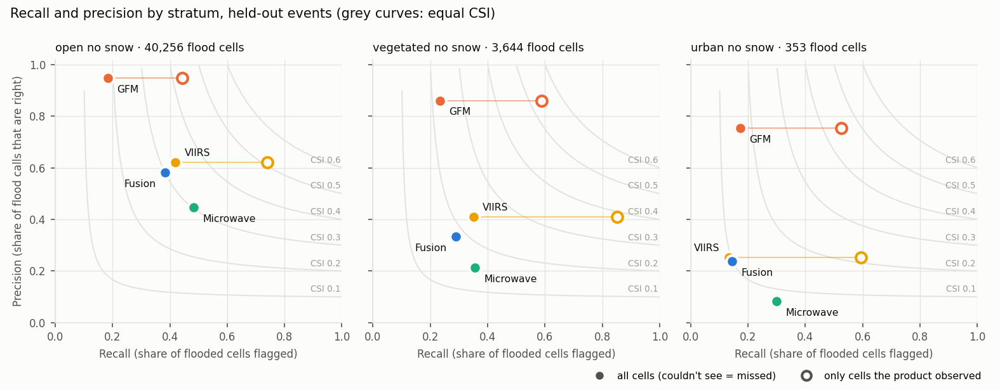

# Flood fusion: final report

First run 2026-10-12; cross-validated run 2026-10-15. Branch `feat/flood-fusion-v1`. Every number below is reproducible from `results/` (tables are generated by `scripts/fusion/report_tables.py` into `results/report_tables.md`).

How every number below is computed (grid cells, gold labels, the hit/miss/false-alarm table, pooling) is in [`docs/methods.md`](methods.md).

## The answer (cross-validated, 2026-10-15)

**Set-up** (ADRs 0003–0007, `docs/methods.md` §10). All 170 usable gold events in Africa, Asia, South America and Oceania, in five folds by HydroBASINS level-4 basin. Every event is scored once, by hit and false-alarm rates fitted on the other four folds, per land type (open, vegetated, urban). In the days before and after each event, cells flooded on a map day get no label (ADR 0006). Scores are on gold-map days: 404,014 gold flooded cell-days, pooled over cells, with 95% intervals from resampling events. Outputs: `results/cv/` (`make crossval`; `scripts/fusion/cv_breakdowns.py`). The same results, with figures, are in the review doc's Results section.

**In short.**
- Fusion has the highest F1 overall (0.44), in Asia (0.49), in open land (0.47) and in vegetated land (0.30). Its lead over the best single product, the microwave vote (0.38), is within the uncertainty.
- **VIIRS is what puts fusion ahead.** Re-run without VIIRS (same folds, rates and prior), fusion scores 0.39 overall, level with the microwave vote. Where VIIRS has files it adds 0.08 F1 (paired 95% interval 0.06–0.10) and raises fusion's F1 on 68 of 109 events. VIIRS's own score (0.22) is low mostly because its archive has no files for 2021-01 to 2023-07, which holds 28% of the gold flood.
- **One basin weighs heavily.** Four UNOSAT Bangladesh floods (2017, 2018, 2020, 2022) in one level-4 basin hold 40% of all gold flooded cell-days. Without them: fusion F1 0.35, microwave vote 0.34, FloodScan 0.33, with overlapping intervals.
- **Criteria:** (a) equal to the microwave vote (both cover almost every cell); (b) passes on the point estimate in open and vegetated land, with overlapping intervals, fails in urban land (GFM better); (c) fails in every land type.
- **Event level:** fusion catches 68% of events (microwave vote 74%, GFM 49%) but raises a false event on 34% (GFM 13%). Caught without a false event: fusion 36%, GFM 39%.
- **Sentinel-1 bias in the gold:** GFM had an image for 7% of floodable cell-days overall, but for 32% of labelled cells on map days and 51% of gold flooded cell-days; map days fall on Sentinel-1 passes, most likely because many maps are drawn from Sentinel-1. On map days whose maps are not from Sentinel-1, GFM's F1 is 0.12 and fusion's 0.46.

**All cells** (a product's gaps count as misses):

| product | recall | precision | F1 |
|---|---|---|---|
| fusion | 0.43 (0.30–0.51) | 0.46 (0.37–0.53) | 0.44 (0.34–0.50) |
| microwave vote | 0.40 (0.32–0.45) | 0.37 (0.31–0.43) | 0.38 (0.32–0.43) |
| FloodScan | 0.34 (0.25–0.39) | 0.42 (0.36–0.48) | 0.37 (0.31–0.42) |
| GFM | 0.14 (0.11–0.19) | 0.86 (0.78–0.91) | 0.24 (0.19–0.31) |
| GFDS | 0.17 (0.12–0.24) | 0.36 (0.29–0.44) | 0.23 (0.18–0.29) |
| VIIRS | 0.14 (0.10–0.22) | 0.52 (0.42–0.62) | 0.22 (0.16–0.31) |

**Without the Bangladesh basin** (166 events, 244,189 gold flooded cell-days):

| product | recall | precision | F1 |
|---|---|---|---|
| fusion | 0.34 | 0.38 | 0.35 (0.29–0.42) |
| microwave vote | 0.37 | 0.31 | 0.34 (0.28–0.39) |
| FloodScan | 0.29 | 0.38 | 0.33 (0.26–0.39) |
| VIIRS | 0.18 | 0.47 | 0.26 (0.17–0.37) |
| GFDS | 0.20 | 0.31 | 0.25 (0.19–0.29) |
| GFM | 0.14 | 0.82 | 0.24 (0.16–0.34) |

With the old dry-window rule (every examined cell dry before and after): fusion 0.38 · 0.46 (F1 0.41).

**F1 per continent** (`results/cv/f1_by_continent.png`):

| continent (events; gold flooded cell-days) | fusion | VIIRS | microwave vote | FloodScan | GFDS | GFM | best single |
|---|---|---|---|---|---|---|---|
| Africa (80 events; 109,025 flooded cell-days) | 0.31 (0.21–0.41) | 0.26 (0.15–0.37) | 0.34 (0.23–0.42) | 0.34 (0.24–0.44) | 0.25 (0.16–0.33) | 0.11 (0.05–0.17) | FloodScan |
| Asia (61 events; 270,263 flooded cell-days) | 0.49 (0.36–0.54) | 0.17 (0.08–0.26) | 0.40 (0.33–0.46) | 0.39 (0.29–0.44) | 0.21 (0.14–0.29) | 0.30 (0.23–0.42) | microwave vote |
| Oceania (13 events; 19,553 flooded cell-days) | 0.45 (0.12–0.54) | 0.53 (0.00–0.68) | 0.43 (0.30–0.50) | 0.43 (0.23–0.51) | 0.31 (0.19–0.36) | 0.17 (0.06–0.38) | VIIRS |
| South America (16 events; 5,173 flooded cell-days) | 0.34 (0.29–0.39) | 0.17 (0.08–0.28) | 0.22 (0.16–0.26) | 0.20 (0.11–0.27) | 0.14 (0.04–0.21) | 0.31 (0.06–0.56) | GFM |

**F1 per land type** (`results/cv/f1_by_landtype.png`):

| land type (events; gold flooded cell-days) | fusion | VIIRS | microwave vote | FloodScan | GFDS | GFM | best single |
|---|---|---|---|---|---|---|---|
| open (167 events; 355,927 flooded cell-days) | 0.47 (0.36–0.54) | 0.23 (0.16–0.32) | 0.41 (0.34–0.47) | 0.40 (0.32–0.45) | 0.24 (0.18–0.31) | 0.24 (0.18–0.33) | microwave vote |
| urban (161 events; 2,209 flooded cell-days) | 0.16 (0.10–0.23) | 0.12 (0.08–0.17) | 0.11 (0.08–0.14) | 0.12 (0.09–0.15) | 0.08 (0.04–0.11) | 0.24 (0.15–0.33) | GFM |
| vegetated (159 events; 45,878 flooded cell-days) | 0.30 (0.23–0.34) | 0.17 (0.10–0.24) | 0.26 (0.20–0.30) | 0.27 (0.22–0.33) | 0.14 (0.10–0.19) | 0.25 (0.17–0.30) | FloodScan |

**Observed cells** (each product only where it saw; fusion on the same cells):

| cells | product: recall · precision (F1) | fusion: recall · precision (F1) | share of gold flood seen |
|---|---|---|---|
| where VIIRS observed | 0.51 · 0.52 (0.52) | 0.44 · 0.45 (0.44) | 28% |
| where microwave vote observed | 0.40 · 0.37 (0.38) | 0.43 · 0.46 (0.44) | 100% |
| where FloodScan observed | 0.34 · 0.42 (0.37) | 0.43 · 0.46 (0.44) | 100% |
| where GFDS observed | 0.23 · 0.36 (0.28) | 0.43 · 0.46 (0.45) | 71% |
| where GFM observed | 0.28 · 0.86 (0.42) | 0.45 · 0.47 (0.46) | 51% |

**Map days whose maps are not from Sentinel-1** (132 events, 158,796 gold flooded cell-days):

| product | recall · precision (F1) | F1 interval |
|---|---|---|
| fusion | 0.49 · 0.43 (0.46) | 0.38–0.53 |
| fusion, old dry-day rule | 0.43 · 0.44 (0.43) | 0.36–0.51 |
| microwave vote | 0.47 · 0.37 (0.42) | 0.35–0.47 |
| FloodScan | 0.38 · 0.44 (0.41) | 0.33–0.48 |
| VIIRS | 0.23 · 0.52 (0.32) | 0.20–0.45 |
| GFDS | 0.26 · 0.36 (0.30) | 0.24–0.35 |
| GFM | 0.07 · 0.73 (0.12) | 0.08–0.16 |

**VIIRS archive gap** (no VIIRS files 2021-01 to 2023-07): F1 by period.

| product | VIIRS archive available (115 events) | VIIRS gap (2021-01 to 2023-07) (55 events) |
|---|---|---|
| fusion | 0.44 (0.32–0.51) | 0.45 (0.22–0.54) |
| VIIRS | 0.29 (0.21–0.38) | 0.00 (0.00–0.00) |
| microwave vote | 0.37 (0.29–0.41) | 0.42 (0.28–0.50) |
| FloodScan | 0.35 (0.27–0.40) | 0.43 (0.27–0.50) |
| GFDS | 0.20 (0.14–0.26) | 0.30 (0.19–0.36) |
| GFM | 0.23 (0.16–0.27) | 0.29 (0.15–0.45) |

Outside the gap VIIRS scores 0.29, against 0.49 on the first run's 29 in-scope test events; cloud over the added Asian monsoon floods is the likely reason (not measured).

The two period columns are different events (every product scores higher on the gap events), so they do not measure what the gap costs. What VIIRS adds, measured by re-running fusion without it (`results/cv/skill_viirs_ablation.csv`):

| events | fusion | fusion without VIIRS | added by VIIRS (paired 95% interval) |
|---|---|---|---|
| 115 with VIIRS files | 0.44 | 0.36 | 0.08 (0.06–0.10) |
| 55 in the gap | 0.45 | 0.45 | none: no VIIRS files |
| all 170 | 0.44 | 0.39 | 0.06 (0.04–0.08) |

So the gap probably costs fusion an optical input's worth on 28% of the gold flood. MODIS could restore an optical input there; its value inside fusion is unmeasured (it has never been run through the engine), and the first-run MODIS comparison (§4, D-37) does not carry over: there fusion without optical input scored F1 0.20 on the gap events, here 0.45.

**Criteria** (CSI for criterion b; reliability slopes by weighted least squares):

| land type | fusion CSI | best single (CSI) | (b) passes | slope, map days | slope, map and dry days | (c) passes |
|---|---|---|---|---|---|---|
| open | 0.31 | microwave vote (0.26) | yes | 0.46 | 0.03 | no |
| vegetated | 0.18 | FloodScan (0.16) | yes | 0.24 | 0.01 | no |
| urban | 0.09 | GFM (0.13) | no | 0.22 | 0.01 | no |

Coverage: fusion has a value on 99.99% of floodable cell-days, the microwave vote on 99.98%, GFM on 7%, VIIRS on 38%. Reliability (`results/cv/reliability_open.png`): on map days in open land, 7% of cells below P 0.1 are flooded and 42–51% of cells at any P from 0.1 to 1; over map days and the days before and after, mean P is 0.039 against a 0.3% flooded share.

**Event level** (ADR 0007; 148 of 170 events have at least 5 floodable gold-flooded cells):

| product | events | caught | false event | caught, no false event | median days to detection |
|---|---|---|---|---|---|
| microwave vote | 148 | 74% (67%–80%) | 53% (45%–60%) | 24% (18%–31%) | -1 |
| fusion | 148 | 68% (59%–75%) | 34% (26%–41%) | 36% (29%–44%) | -2 |
| GFDS | 148 | 60% (52%–68%) | 39% (31%–47%) | 24% (18%–31%) | 0 |
| fusion, old dry-day rule | 148 | 59% (51%–66%) | 26% (19%–33%) | 36% (28%–43%) | -1 |
| FloodScan | 148 | 55% (48%–64%) | 32% (26%–41%) | 28% (21%–36%) | 0 |
| VIIRS | 148 | 53% (45%–61%) | 39% (31%–47%) | 16% (10%–23%) | -2 |
| GFM | 148 | 49% (41%–57%) | 13% (8%–19%) | 39% (32%–47%) | 0 |

**Water versus flood** (`scripts/fusion/cv_normally_wet.py`, `results/cv/normally_wet_*.csv`). Every result split by whether a cell is normally wet in that calendar month (the D-38 JRC rule), same models:
- Normally-wet cells are 7% of labelled cells on map days but hold 38% of the gold flood. Each source's false-alarm rate is 3 to 11 times higher there (GFM 5.6% against 0.5%), so one rate per land type is wrong for both: a normally-wet stratum is justified.
- Fusion's lead is larger there: F1 0.60 (0.46–0.66) against the microwave vote's 0.49 (0.42–0.54), a gap of 0.11; on other cells 0.36 against 0.34, a gap of 0.02. The intervals overlap in both. Whether that water is flood or normal cannot be told with these labels.
- It does not explain the over-confidence: probabilities stay flat above P 0.1 within each group (slopes 0.29 and 0.34), which points to the engine rather than the definition of flood. Nor most of the correlated errors: the coincidence lift is larger on other cells (3.7–10) than on normally-wet cells (1.6–2.4).
- False events are more frequent on normally-wet footprints (fusion 44% against 30%) but common elsewhere.
- **Not every "false alarm" there is wrong.** Gold labels normally-wet cells 52% flood and 48% dry on map days: the analysts sometimes leave normal water out of the flood (a river channel) and sometimes count it (a seasonal wetland). A product that reports water on a gold-dry, normally-wet cell is right about the water. Of fusion's 202,714 flood calls on gold-dry cells, 39,076 (19%) are of that kind; not counting them, precision would be 0.51 instead of 0.46. The other 81% are on normally-dry cells (coarse microwave cells reaching past the flood edge, unmapped water, water the JRC record misses, or errors). Worked map: `docs/figures/water_vs_flood_cells.png` (`scripts/fusion/figure_water_vs_flood.py`).
- So the product estimates water outside permanent water on event days (what gold calls flood). A water-first design would make the target explicit but would not by itself fix calibration.

**What these scores cannot show.** Precision is measured inside mapped floods (12% of labelled open-land cells on map days are flooded); on ordinary days it will be far lower, and is not measured yet. Pooled scores follow the largest floods. MODIS (to fill the VIIRS gap), ordinary-day precision on the global sample, a gauge test, and the FloodScan licence outside Africa remain open (§6).

## The first run (2026-10-12): one split, all continents, six strata

Everything from here to §8 describes the first run: 198 events on six continents, one fitting/test split (149/49), six strata and the literal dry-window rule. It is kept as the record of that run; the cross-validated section above supersedes its results.

### The answer first (first run)

**What was built.** The v1 design is built as specified and tested end to end. It is a daily product on a 0.01° (~1 km) grid over the floodable domain, combining three independent sensor families in log-odds:
- **GFM** (Sentinel-1 SAR);
- **FloodScan OR GFDS** (passive microwave);
- **NOAA VIIRS flood maps** (optical), standing in for MODIS, which cannot be reached.

Each day it writes three layers: P(flooded), uncertainty (|log-odds| and the number of sources observed), and days since the last observation.

**What it was tested on.** 49 held-out gold events (EMS and UNOSAT). They were never used for fitting and are split from the training events by basin.

**Against your three criteria, the product as specified does not meet the bar for "better than any single product":**

| criterion | result |
|---|---|
| (a) daily coverage of the floodable domain above any single product | **met, trivially.** 100% vs 99.9% for the microwave vote, which by itself covers nearly everything. GFM covers 10%, VIIRS 55%. |
| (b) CSI per stratum ≥ the best single product in that stratum | **not met in any stratum.** Open/no-snow: 0.30 vs VIIRS 0.33 (recall · precision 0.38 · 0.58 vs 0.42 · 0.62). Vegetated: 0.18 vs VIIRS 0.23. Urban: 0.10 vs GFM 0.16. The snow strata are too thin to judge. |
| (c) reliability slope 0.8–1.2 | **not met.** As specified (gold days plus dry windows), the slope is about 0.01. Most of that is a labelling artefact (D-39): the dry windows label still-flooded cells dry. **On gold days only, the slope is 0.47 in open land, 0.34 vegetated, 0.27 urban**: still too extreme, but far less, and the mean P there is at or below the real flood rate. |

> **Update 2026-10-13 (D-39).** The dry windows label every footprint cell dry, including cells still flooded after the last gold map. Only 2% of the high-probability cell-days fall on gold days, so this produced most of the measured over-confidence. It also roughly doubled the false-alarm rates the model learned. A corrected variant (formerly flooded cells left unlabelled in the dry windows) raises held-out recall from 0.37 to 0.44 at unchanged precision 0.55 (CSI 0.285 → 0.322). In open land it reaches 0.46 · 0.58 (CSI 0.341), above VIIRS's 0.333. That change touches fixed decision 5 and is proposed, not adopted. Details: §4 Reliability, D-39.

**Overall it is mid-pack.** Across all strata, fusion flags 37% of the gold-flooded cells (**recall 0.37**), and 55% of its flood calls are right (**precision 0.55**).
- **VIIRS:** recall 0.41 and precision 0.60.
- **GFM:** the most precise product (0.94), but recall only 0.19, mostly because it observes 10% of the domain.
- **The microwave vote:** the highest recall (0.47), but precision 0.41.

CSI, which combines recall and precision: VIIRS 0.319, fusion 0.285, microwave 0.280, FloodScan 0.248, GFDS 0.198, GFM 0.184.

**Where a single product actually observed, it beats fusion** (§4):
- **On cells GFM observed:** GFM has recall 0.45 and precision 0.94; fusion 0.34 and 0.63. Fusion misses floods GFM catches and adds false alarms.
- **On cells VIIRS observed:** VIIRS has 0.75 and 0.60; fusion 0.46 and 0.57. Here fusion loses on recall: one VIIRS flood report lifts a cell from the low prior only to about P 0.02.

Fusion's headline lead over GFM comes from counting GFM's unobserved cells as misses.

**One experiment points to a gain in open land; it is not established.** On training events only, I fitted a per-stratum recalibration of the fused log-odds and, separately, picked the decision threshold that maximised CSI. Both were then applied unchanged to the held-out events (§4):
- **Calibration improves but still fails criterion (c).** In open/no-snow the reliability slope rises from 0.01 to 0.68 (logistic calibration slope 0.15 → 0.87). The target is 0.8–1.2.
- **The gain comes from the threshold, not the recalibration.** In open/no-snow, calling a cell flooded when the v1 P ≥ 0.02 (instead of 0.5) changes held-out scores as follows:
  - recall rises from 0.38 to **0.53**;
  - precision falls only from 0.58 to **0.56**;
  - for comparison, VIIRS has 0.42 and 0.62;
  - CSI goes to 0.372 against VIIRS's 0.333.

  The recalibrated probabilities never reach 0.5, so at the spec's threshold they flag nothing.
- **Caveats.** 0.02 is the lowest threshold searched. The same threshold scored only 0.252 on training events. There is no confidence interval on the difference.
- **Vegetated and urban strata** did not improve.

This is a single exploratory run, not part of the product.

**Scope limits that matter as much as the scores:**
- **No global run.** The engine and daily job are tiled and global-capable. But the one-off global build of the static layers (HAND, permanent water, land cover over about 15,000 land tiles) was too heavy for a laptop and was **not run**.
- **What v1 does cover:** every held-out event window (daily COGs for all of them), plus the scheduled job's two AOIs, Nigeria (Niger–Benue) and Chad (Logone–Chari).
- **Inputs are disappearing.** The GFDS feed ended on 2026-09-14. FloodScan outside Africa ends on our blob on 2026-03-31. So today the microwave vote exists only in Africa, which leaves GFM and VIIRS elsewhere.
- **Resolution.** The product is deliberately coarser than GFM's 20 m. A cell counts as flooded only if at least 30% of it is flooded, so narrow or small floods are not represented.
- **Licence.** FloodScan is a commercial input, and products derived from it cannot be shared outside OCHA without AER approval.

## 1. Inventory (detail: `docs/inventory.md`)

| input | used as | reachable for v1 |
|---|---|---|
| Copernicus GFM (STAC, 20 m, 2015 →) | SAR source | yes; read at the 80 m overview (validated: 99.5% agreement on flood/dry at 0.30) |
| AER FloodScan SFED v05r01 (300″) | microwave, with GFDS | Africa through 2026-10-10 (prod); Asia-Australia and the Americas through 2026-03-31 (dev raw NetCDF); **Europe never** |
| JRC/GDACS GFDS signal (0.09°) | microwave, with FloodScan | 1997 → **2026-09-14 (feed ended)**; 60 of 4,116 needed days absent |
| NOAA/GMU VIIRS flood v2r0 (375 m) | optical source | 2012–2020 and 2023-08 →; **no data 2021-01 → 2023-07** |
| NASA MODIS MCDWD | (planned optical) | **no.** Needs an Earthdata login, which is not configured |
| CEMS rapid mapping (gold v1), UNOSAT (gold v2) | gold | yes; 353 usable events, 198 used |
| GLO-30 HAND, JRC GSW v1.4, ESA WorldCover 2021, ERA5-Land snow cover, HydroBASINS, Köppen-Geiger | static layers, split, sample design | yes (ERA5-Land stands in for the MODIS snow climatology) |

## 2. Feasibility gate (detail: `docs/feasibility.md`)

| test | result | threshold |
|---|---|---|
| oracle gain (best source per stratum with hindsight vs best overall single source, CSI on observed cells) | **+1.6 points** | ≥ 3 |
| 3-day coverage gain over GFM alone | **+93 pp** | ≥ 15 |

**Decision: continue in full**, because the coverage criterion passed. Before the numbers were computed, the gate write-up recorded that coverage would pass by construction through the microwave vote. The weak oracle gain, meaning the sources are not strongly complementary in accuracy, was the warning sign that Phase 5 confirmed.

## 3. Training data and the accuracy table

**Training data:**
- **Events:** 198 gold events on six continents, 149 for training and 49 held out, split by HydroBASINS level-4 basin and stratified by continent. They comprise 187 events chosen cost-ordered within continent quotas, plus 11 added to cover snow season.
- **Event cubes:** 437 window cubes covering 30 days before to 60 days after each event.
- **Random sample:** 53 blocks (0.25° random, 0.5° city), stratified by Köppen group × continent, covering 2023–2025. All six strata have at least 2 million cell-days (`results/phase2_sample_cell_days_by_stratum.csv`).

**Accuracy table** (`results/accuracy_table.csv`). Gold confusion matrices pooled over training gold days and matched dry windows, Jeffreys-smoothed, with event-cluster bootstrap 95% intervals and sample sizes for every number. Three strata used Dawid–Skene EM, initialised from the nearest stratum: two because VIIRS had no gold flood observations there, and urban/snow because it has fewer than 50,000 gold cell-days. Main rows:

| stratum | GFM sens / spec | microwave sens / spec | VIIRS sens / spec |
|---|---|---|---|
| open, no snow | 0.29 [0.20–0.47] / 0.987 | 0.26 [0.18–0.35] / 0.949 | 0.66 [0.47–0.78] / 0.945 |
| vegetated, no snow | 0.32 / 0.994 | 0.22 / 0.979 | 0.68 / 0.987 |
| urban, no snow | 0.37 / 0.999 | 0.26 / 0.954 | 0.30 / 0.995 |
| snow strata | EM; three rows prior-dominated (flagged) | EM | EM |

**Flags:**
- **15 of the 18 rows have a 95% interval wider than 0.15,** and 17 are flagged in all. The other two are prior-dominated EM rows, flagged regardless of width. Sensitivity varies a great deal from event to event. Specificities are tight.
- **The snow strata are weakly identified.** They have 83, 81 and 0 training gold flood cells.

**Prior v1** (`results/prior_v1.csv`) is GFM's flood rate in the random sample, per stratum:

| stratum | base rate |
|---|---|
| open/no-snow | 0.0016 |
| vegetated/no-snow | 0.00046 |
| urban/no-snow | 0.000037 |
| open/snow | 0.0078 |
| vegetated/snow | 0.0018 |
| urban/snow | 0.00054 |

The planned estimator was the prevalence MLE with the gold sensitivity and specificity. It collapsed to its bound, because false alarms measured beside flood events run higher than on random days (D-35). It is kept in the file as a diagnostic.

**Recession check** (`results/phase3_post_window_pofd.csv`). Every source's false-alarm rate is higher in days 1–30 after an event than in days 31–60 (GFM 1.6% vs 0.6%). The literal 60-day post window (D-12) therefore counts some genuine recession water as false alarms, which biases specificity low.

**Prior v2 (GloFAS)** was not built. Access plus the build would have exceeded the 5% budget (D-21).

## 4. Validation on held-out events (`results/phase5_*`)

The daily outputs (COG: P, |L|, number of sources observed, days since observation) exist for **every day of all 85 held-out event windows**: 8,277 files in `data/fusion/out/daily/`.

**Blob status (complete 2026-10-12 19:55).** The mirror to dev `projects/ds-flood-gfm/` holds:
- `MANIFEST.json`, all results tables and figures, and all 490 static COGs;
- all 8,277 held-out daily COGs, plus the 7-day Lokoja demo;
- the cubes and the raw inputs.

Only the optional GFDS row-band archive (5.5 GB) is not uploaded: `uv run python scripts/fusion/phase6_package.py --only-gfds-bands`.

For a while the upload ran at about 30 KB/s. The cause was not measured: Google Drive sync was busy on the same machine at the time.

### Skill by stratum (gold days; a source's NoData counts as "not detected")

Scores used here:
- **recall:** the share of gold-flooded cells a product flags;
- **precision:** the share of its flood calls that gold confirms;
- **CSI** = hits ÷ (hits + misses + false alarms): combines both, and is what criterion (b) uses.

**Recall · precision** by stratum:

| stratum (held-out gold flood cells) | fusion | GFM | microwave | VIIRS | FloodScan | GFDS |
| --- | --- | --- | --- | --- | --- | --- |
| open, no snow (40,256) | 0.38 · 0.58 | 0.18 · 0.95 | 0.48 · 0.45 | 0.42 · 0.62 | 0.33 · 0.56 | 0.31 · 0.42 |
| vegetated, no snow (3,644) | 0.29 · 0.33 | 0.23 · 0.86 | 0.36 · 0.21 | 0.35 · 0.41 | 0.29 · 0.34 | 0.15 · 0.14 |
| urban, no snow (353) | 0.14 · 0.24 | 0.17 · 0.75 | 0.30 · 0.08 | 0.13 · 0.25 | 0.15 · 0.11 | 0.22 · 0.08 |

The snow strata have 24 and 332 held-out flood cells, too few to read; their numbers are in `results/report_tables.md`.

**CSI by stratum, for criterion (b)** (bold = best):

| stratum (held-out gold flood cells) | fusion | GFM | microwave | VIIRS | FloodScan | GFDS |
|---|---|---|---|---|---|---|
| open, no snow (40,256) | 0.300 | 0.181 | 0.303 | **0.333** | 0.259 | 0.217 |
| vegetated, no snow (3,644) | 0.183 | 0.224 | 0.154 | **0.232** | 0.186 | 0.079 |
| urban, no snow (353) | 0.099 | **0.164** | 0.070 | 0.096 | 0.068 | 0.062 |
| open, snow (24) | 0.125 | **0.333** | 0 | 0 | 0 | 0 |
| vegetated, snow (332) | 0.033 | **0.053** | 0 | 0 | 0 | 0 |
| urban, snow (0) | no held-out gold | | | | | |

Skill on each source's own observed cells, with fusion scored on the same cells, is in `results/phase5_skill_by_stratum.csv` and `results/phase5_skill_overall.csv` (`mode = conditional`).

**On the cells a single product actually observed, that product beats fusion** (all strata):

| cells scored | that product: recall · precision | fusion on the same cells: recall · precision |
|---|---|---|
| where GFM observed | 0.45 · 0.94 | 0.34 · 0.62 |
| where VIIRS observed | 0.75 · 0.60 | 0.46 · 0.57 |

CSI: 0.440 vs 0.283, and 0.495 vs 0.341.

So fusion's lead over GFM in the tables above comes from scoring GFM's unobserved cells as misses. Where a good observation exists, fusion is worse for two reasons:
- **False alarms from the other sources.** On GFM's cells, precision drops from 0.94 to 0.63. The microwave vote's own precision is 0.41, and coinciding false alarms are counted as independent votes (Reliability, below).
- **One report is not enough.** On VIIRS's cells, recall drops from 0.75 to 0.46. Open land's base rate is P 0.0016.
  - One VIIRS flood report lifts a cell only to P 0.02.
  - Reaching 0.5 takes all three sources saying flood on the same day (P 0.69), or VIIRS saying flood three days running (four if microwave says dry).

**These skill scores are point estimates.** Phase 5 has no bootstrap intervals (only the accuracy table does). The direction is consistent: fusion is below the best single product in every stratum and in 5 of 6 continents. The size of each gap is not established.

### By continent (all strata)

| continent | fusion: recall · precision (CSI) | best single by CSI: recall · precision (CSI) |
|---|---|---|
| South America | **0.42 · 0.27 (0.196)** | microwave 0.35 · 0.22 (0.157) |
| Asia | 0.33 · 0.64 (0.280) | microwave 0.46 · 0.43 (0.286) |
| Africa | 0.15 · 0.23 (0.100) | microwave 0.24 · 0.23 (0.132) |
| Oceania | 0.53 · 0.56 (0.376) | VIIRS 0.78 · 0.65 (0.545) |
| Europe | 0.11 · 0.17 (0.070) | GFM 0.16 · 0.65 (0.145) |
| North America | 0.01 · 0.03 (0.008) | VIIRS 0.55 · 0.55 (0.378) — 544 flood cells; explained below |

### Reliability

Measured over gold days plus dry windows (the plots above), the observed flood frequency stays near 0.01 at every predicted probability.

**Most of that is a labelling artefact** (D-39; `scripts/fusion/diagnostic_dry_windows.py`, `results/diagnostic_dry_windows_*.csv`):
- **The labels.** The dry windows label every footprint cell dry for 30 days before and 60 days after the gold days, including cells flooded on them.
- **Where the high P is.** Only 2% of cell-days with P ≥ 0.5 fall on gold days. In open land, cells flooded on a gold day sit at P ≥ 0.5 on 48% of the 30 days after the event: that is receding water, scored as false alarm.
- **On gold days only** the slope is 0.47 (open), 0.34 (vegetated) and 0.27 (urban). The mean P is at or below the observed frequency (open land: 0.15 vs 0.22). Cells at P ≥ 0.5 flood 58% of the time.

**What remains on gold days** is a probability that is still too extreme: about 4 times too extreme on the log-odds scale (logistic slope 0.21–0.27). Two kinds of dependence were checked:
- **Repetition at the same cell.** Errors that recur at a cell day after day accumulate under the 0.9 carry-over to (L − prior)∞ = w/(1 − 0.9) = 10·w. But two "evidence only on change" ablations (D-33) did not repair the slope (logistic 0.22 and 0.27). So day-to-day repetition is not the main part.
- **Sources wrong together: measured, and large** (2026-10-13, `results/phase3_gold_error_dependence.csv`).
  - On gold-dry training cells, two sources' false alarms coincide 4–18 times more often than independence predicts. In open land without snow, microwave and VIIRS made 141,077 joint false alarms, 5.2 times the independent expectation.
  - Most of those joint false alarms fall in the dry windows (54% in the 30 days after the event; D-39). The lift is about the same on gold days alone (4.3; 2.2 within the same event), so the dependence is real even though its volume was inflated.
  - Within the same event the excess is still 2–9 times, so it is the same cells, not just some events being wetter.
  - Misses on flooded cells barely coincide (1.0–1.5 times).
  - Naive Bayes counts two coinciding false alarms as two independent votes for flood. That is the measured cause of what remains of the over-confidence once the labelling artefact is set aside.

(An earlier version of this report also blamed spatially correlated errors. That was wrong: spatial correlation between cells widens the uncertainty of the calibration estimate, but it does not bias a per-cell probability.)

**The same accumulation also makes the product slow to react.** In North America, VIIRS says flood on 299 of the 544 held-out gold flood cells. On none of them does the fused P reach 0.5, and its median there is about 0, even though the microwave vote agrees on 152 of those cells. The reason: in the weeks before a flood, daily "dry" evidence accumulates too. VIIRS dry adds −1.0 a day and microwave dry −0.25. Measured the day before the first gold map, those cells sit a median **8.3 log-odds below the prior** (10th percentile −10.0, 90th −4.0), and a few days of flood evidence cannot climb out of that.

### Coverage, observation age, time to first detection

**Coverage of the floodable domain**, held-out windows, every day:

| source | coverage |
|---|---|
| GFM | 10.2% |
| VIIRS | 54.6% |
| FloodScan | 90.8% |
| GFDS | 84.1% |
| microwave | 99.9% |
| fusion, same day | 100% |
| fusion, within 3 days | 100% |

**Days since the last observation** are 0 almost everywhere, because the microwave vote observes daily. While microwave inputs exist, this layer carries little information. It becomes informative where they have ended.

**Time to first detection.** Of 66 held-out windows with gold flood, fusion detects the flood (at least 10% of the gold footprint flagged) in 32, with a median of 1 day after the first gold map. That matches GFM (31 windows, 1 day) and VIIRS (32 windows, 0.5 days). Microwave "detects" a median 24 days *before* the first gold map: that is persistent false alarms or seasonal water, not early warning.

### Ablation (held-out, all strata)

| model | recall | precision | CSI | CSI change vs full |
|---|---|---|---|---|
| full | 0.37 | 0.55 | **0.285** | — |
| drop VIIRS | 0.22 | 0.44 | 0.170 | −0.115 |
| drop microwave | 0.29 | 0.62 | 0.244 | −0.041 |
| drop GFM | 0.33 | 0.52 | 0.256 | −0.029 |
| microwave = FloodScan only | 0.35 | 0.59 | 0.281 | −0.004 |
| microwave = GFDS only | 0.33 | 0.57 | 0.261 | −0.024 |
| microwave evidence only on change | 0.32 | 0.62 | 0.268 | −0.018 |
| all sources evidence only on change | 0.13 | 0.72 | 0.128 | −0.158 |

**What the ablation says:**
- **Every source contributes.** VIIRS contributes most.
- **The FloodScan OR GFDS merge adds almost nothing over FloodScan alone.** GFDS mainly adds false alarms.
- **MODIS could not be ablated because it was never available.** VIIRS's weight in the ablation suggests a second optical sensor would be the most valuable missing input.

### Recalibration experiment (`results/experiment_recalibration.csv`; not the product)

**Method** (`scripts/fusion/experiment_recalibration.py`, run once). On training events only:
1. **Recalibration.** Fit, per stratum, a logistic correction logit P = a + b·L to the fused log-odds L. In open/no-snow b = 0.084: the fused log-odds look about 12 times too extreme. The fit pooled the literal dry windows, so most of that factor is the labelling artefact (D-39). On gold days alone the logistic slope is 0.21, about 4 times.
2. **Threshold.** Separately, try thresholds 0.02, 0.04, … 0.98 on the v1 P and keep the one with the best training CSI.

Both were applied unchanged to the held-out events.

Reliability here uses 10 quantile bins, because recalibrated probabilities all fall in the lowest equal-width bin. So the v1 slopes differ slightly from §4. "WLS" is the reliability slope that criterion (c) uses.

| stratum | WLS slope, v1 → recalibrated | logistic slope, v1 → recalibrated | v1 at P ≥ 0.5: recall · precision | recalibrated at P ≥ 0.5 | v1 at trained threshold: recall · precision (held-out CSI; training CSI) | best single: recall · precision |
|---|---|---|---|---|---|---|
| open, no snow | 0.01 → 0.68 | 0.15 → 0.87 | 0.38 · 0.58 | flags nothing | P ≥ 0.02: 0.53 · 0.56 (0.372; 0.252) | VIIRS 0.42 · 0.62 |
| vegetated, no snow | 0.02 → 2.97 | 0.28 → 1.55 | 0.29 · 0.33 | flags nothing | P ≥ 0.16: 0.32 · 0.32 (0.187; 0.147) | VIIRS 0.35 · 0.41 |
| urban, no snow | 0.01 → 1.66 | 0.18 → 1.12 | 0.14 · 0.24 | flags nothing | P ≥ 0.02: 0.20 · 0.15 (0.092; 0.068) | GFM 0.17 · 0.75 |

The snow strata have too few held-out gold flood cells to read (24 and 332).

**What it shows:**
- **Calibration.** Much better in open/no-snow, but still outside 0.8–1.2 on the WLS slope. It overshoots in vegetated and urban land.
- **Recall and precision.** The gain comes entirely from the lower threshold. In open land, recall rises by 0.15 while precision falls by 0.03. Recalibration is monotone, so on its own it cannot change the map, and at 0.5 the recalibrated P flags nothing.

**What it does not establish:**
- 0.02 is the lowest threshold searched, so the optimum may lie below it.
- Held-out CSI (0.372) is well above training CSI (0.252) at the same threshold, which points to event-mix noise.
- There is no confidence interval on 0.372 vs 0.333.

### Agreement accuracy table (plan v2, ADR 0002; D-36)

**Estimating each source's accuracy from how the three sources agree, without gold, does not work on these sources. Every stratum keeps its gold values.**

- **Best case:** synthetic data with independent errors, at the sample's real rarity and observation rates. Specificity comes back within about ±0.0005, but sensitivity does not:
  - open land: GFM 0.24–0.41, VIIRS 0.45–0.93 (5th–95th percentile over 8 samples);
  - vegetated and urban land: close to the whole 0–1 range.
- **Real sample:** the "flood" class the method finds in open land covers 2.4% of cell-days, 15 times the base rate. VIIRS sees 53% of it and GFM only 4%, which fits the products' different water baselines, not gold flood. Vegetated and urban fits are unstable.
- **Comparison with gold:** per row, 1 agree, 2 diverge, 6 unstable, 9 with no gold to check. A stratum switches only if all its sources agree, and none do.
- **Why:** the sources' false alarms coincide 4–18 times more often than independence predicts (§4, Reliability). That breaks the agreement method's core assumption, and it is the same cause as the product's over-confidence.

### Seasonal "normally wet" baseline (D-38): rejected

**Masking flood calls on cells that are normally wet in that calendar month makes every source worse.** The baseline is JRC GSW monthly recurrence (1984–2021, 30 m); its thresholds were fixed before the test (`scripts/fusion/experiment_seasonal_baseline.py`).

| events | gold flood on normally-wet cells | VIIRS recall · precision, before → after | microwave recall · precision, before → after |
|---|---|---|---|
| held-out | 22% | 0.41 · 0.60 → 0.35 · 0.59 | 0.47 · 0.41 → 0.39 · 0.38 |
| training | 26% | 0.17 · 0.45 → 0.14 · 0.42 | 0.26 · 0.27 → 0.20 · 0.23 |

- **Why recall falls.** The gold maps count seasonal water as flood, so masking it removes true hits.
- **The coinciding false alarms are not seasonal water.** In held-out open land, the lift rises from 4.1 to 5.3 after masking.

### MODIS in the VIIRS archive gap (D-37)

**NASA's MODIS flood product (MCDWD, 2000–2025, now reachable with an Earthdata token) fills the optical gap.** It was scored on the 52 events whose gold days fall in 2021-01 to 2023-07, when the NOAA VIIRS archive is empty:

| same 249 event-days | recall · precision | CSI |
|---|---|---|
| MODIS OR GFM | 0.27 · 0.76 | 0.247 |
| microwave vote | 0.28 · 0.37 | 0.189 |
| MODIS 1-day | 0.19 · 0.73 | 0.175 |
| fusion v1 (no optical input in the gap) | 0.13 · 0.45 | 0.112 |
| GFM | 0.10 · 0.87 | 0.101 |

Making MODIS part of the optical vote needs MODIS over whole event windows (about 100+ GB of tiles). That's a Databricks job.

## 5. Where fusion beats single sources, and where it does not

**Where it wins:**
- **Daily coverage.** Every floodable cell has a value every day, and every gap is filled. Its value depends entirely on the microwave vote.
- **Recall over GFM, FloodScan and GFDS, when unobserved cells count as misses.** Fusion flags more of the flooded cells (0.37) than GFM (0.19), FloodScan (0.32) or GFDS (0.30), at precision 0.55. On the cells GFM actually observed, GFM alone is far better (§4).
- **South America.** Fusion is the best product there.
- **Possibly, large open floodplains with a lower threshold.** With a threshold learned on training events (P ≥ 0.02), fusion's recall in open/no-snow rose to 0.53 at precision 0.56, against VIIRS's 0.42 and 0.62 (CSI 0.372 vs 0.333). That rests on one run, with no interval and the threshold at the edge of the search (§4).

**Where it loses:**
- **Vegetated and urban land.** GFM or VIIRS alone is better.
- **Oceania and North America.** VIIRS alone is better.
- **Europe.** GFM alone is better. Europe has no FloodScan, GFDS has ended, and CEMS maps there are small.
- **Wherever a good single observation exists.**
  - On cells GFM observed: GFM has recall 0.45 and precision 0.94, against fusion's 0.34 and 0.63.
  - On cells VIIRS observed: VIIRS has 0.75 and 0.60, against 0.46 and 0.57.
- **Snow season.** There are too few gold floods to say.
- **The probabilities themselves.** They should not be read as probabilities, even after the experimental recalibration (§4). They work as a ranking score only.

## 6. Open issues

1. **Calibration fails (criterion c).** Most of the reported failure (slope 0.01) is the dry-window labelling (D-39). On gold days the slope is 0.27–0.47, still failing; the remaining cause is that the sources' false alarms coincide about 4 times more often than the model assumes (§4). With the current labels criterion (c) cannot be measured cleanly: never-flooded footprint cells still reach P ≥ 0.5 on 2–7% of dry-window days, and those are either false alarms or water the analysts did not map.
2. **Inputs are disappearing.**
   - GFDS ended on 2026-09-14.
   - FloodScan outside Africa ends on our blob on 2026-03-31. The AER 90-day zips on the dev blob after that are not integrated, and the prod `processed/global/` folder is empty.
   - MODIS needs an Earthdata login.
   - VIIRS has no data for 2021-01 → 2023-07, so 46 events had no optical input.
3. **No global static build, so no global daily product yet.** The `flood_fusion_static` job exists and the global build has not been run (about 15,000 tiles).
4. **The prod schedule is not deployed.** The dev job (Databricks 718536903707906) is deployed with its schedule paused, and it ran once successfully on Job Compute. Prod needs this branch merged to `main` (D-27).
5. **The snow and urban strata are thin.** Urban/snow has no gold flood cells at all; its parameters are EM and partly copied from the donor stratum, flagged as such.
6. **Dry-window labels** (A-02, D-39). Measured: they inflated false-alarm rates (open-land VIIRS 5.5% vs 2.6% when formerly flooded cells are excluded) and produced most of the measured over-confidence. Corrected variant: held-out CSI 0.285 → 0.322. Proposed; adopting it changes fixed decision 5.
7. **Event selection is biased toward smaller events** by the cost caps; Pakistan 2022 and Bangladesh 2020 are excluded. The 141 events beyond the quotas and the 5 unbuilt UNOSAT giants are unused.
8. **Slow reaction to a new flood.** Accumulated dry evidence keeps P near 0 for new floods. North America is the clearest case: fusion recall 0.01 vs VIIRS 0.55 (§4).
9. **A day missing from the FloodScan Africa archive** (archive lag) is now recorded in the daily run manifest (`floodscan_africa_absent`), as GFDS absence is. Before this fix it was silent NoData.
10. **Other:**
   - GSW v1.4 has known occurrence errors; v1.5 exists (D-28).
   - FloodScan licence: outputs are internal only.
   - The days-since-observation layer is uninformative while microwave is daily.
   - The KB page for the dataset is a draft PR.
11. **No confidence intervals on the Phase 5 skill scores.** Every comparison with a single product is a point estimate. An event-cluster bootstrap (as used for the accuracy table) is needed before any margin is quoted as real.

## 7. Next improvements, ranked (revised 2026-10-13 after the dry-window diagnostic)

0. **Adopt the corrected dry windows** (D-39). It's measured, cheap, and changes no code path except the labels: held-out recall 0.37 → 0.44 at unchanged precision 0.55 (CSI 0.285 → 0.322; open land 0.341 vs VIIRS 0.333). It changes fixed decision 5, so it needs your sign-off. Then rebuild the accuracy table with intervals and re-run Phase 5.
1. **Model the dependence between sources.** It is the measured cause of what remains of the over-confidence on gold days (§4, D-36).
   - Learn the evidence for each *combination* of the day's reports from gold: per stratum, the 27 flood/dry/no-data patterns of the three sources. Where gold is thin, shrink towards naive Bayes.
   - The 2026-09-18 spec's stacked logistic regression with interaction terms is the alternative.
   - Either can be scored on the held-out cubes already on disk.
   - It changes fixed decision 7 (naive Bayes), so it needs your sign-off.
2. **Test the learned threshold and the recalibration properly.** The code is in `scripts/fusion/experiment_recalibration.py`. One run, in open/no-snow at P ≥ 0.02: recall 0.38 → 0.53 and precision 0.58 → 0.56 (VIIRS 0.42 and 0.62; CSI 0.300 → 0.372, against 0.333). Calibration improved but did not reach criterion (c): WLS slope 0.68, logistic 0.87.
   - Before relying on it: extend the threshold search below 0.02 and put event-cluster bootstrap intervals on the gain.
   - It treats the symptom; item 1 treats the cause.
3. **Restore the inputs the daily product depends on, then build the static layers globally.**
   - Ingest FloodScan for all regions after 2026-03-31: the AER API or the 90-day zips, which also fills the prod `global/` path the KB expects.
   - Configure an Earthdata login for MODIS MCDWD.
   - Run `flood_fusion_static` over all land tiles.

   Without this the operational product outside Africa is GFM plus VIIRS only.

Smaller items:
- **Drop GFDS where FloodScan exists.** On held-out gold days, adding GFDS to the microwave vote adds 6,656 hits but 17,246 false alarms. In the fused product the OR is worth only 0.004 CSI.
- **Bound the accumulated state.** Cap |L − prior|, or decay dry evidence faster, so that weeks of "dry" cannot bury a new flood. This targets the North America failure (§4); not tested. It changes fixed decision 6.
- **The gauge test** (plan Phase 5): candidate sources are in `docs/gauge_sources.md`, and the choice is pending.

## 8. Deliverables and how to reproduce

| deliverable | where |
|---|---|
| code, one entry point per phase | `Makefile` (`make phase0` … `make phase6`, `make test`, `make daily`), `scripts/fusion/`, `src/ds_flood_gfm/fusion/` |
| tests (45, synthetic) | `tests/` |
| accuracy table with sample sizes and 95% intervals | `results/accuracy_table.csv` |
| daily outputs for every held-out window | 8,277 COGs, locally (`data/fusion/out/daily/`) and on dev blob `projects/ds-flood-gfm/processed/flood_fusion_v1/daily/` (§4) |
| dataset card | `…/flood_fusion_v1/MANIFEST.json`, written by `phase6_package.py` as the second upload step; registration page is KB draft PR #757 |
| scheduled job | `databricks.yml`; dev jobs "[dev] Flood Fusion Daily" (718536903707906, schedule paused) and "Static Build" (186374068781759). **Executed once on Job Compute**: run 876940144771744 succeeded for 2026-10-10. It covered 24 tiles over both AOIs from a cold start and wrote daily COGs, state, static cache and a run manifest that records GFDS as absent. Prod deploy comes after merge. |
| docs | `docs/repo_audit.md`, `docs/inventory.md`, `docs/feasibility.md`, `docs/decisions.md` (D-01–D-35), `docs/assumptions.md`, ADR 0001 |
| runbook | `README.md` "Flood fusion v1", `CLAUDE.md` |
