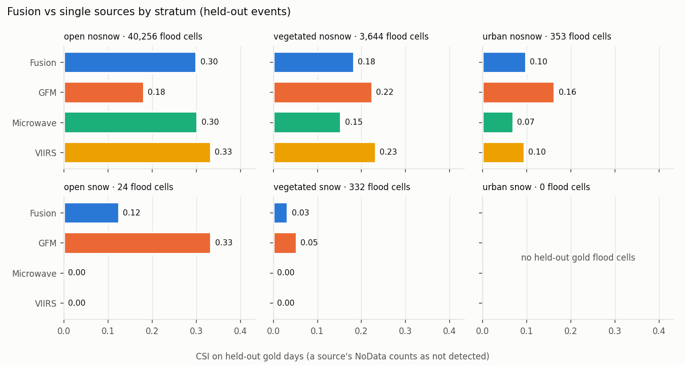
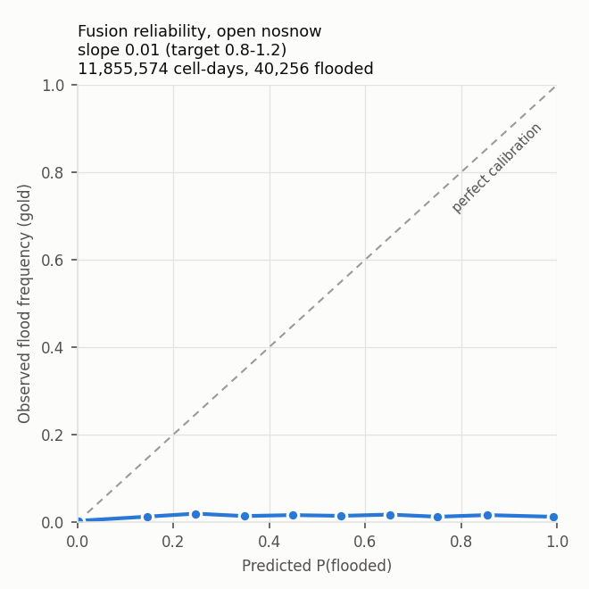

# Flood fusion v1: final report

2026-10-12. Branch `feat/flood-fusion-v1`. Every number below is reproducible from `results/` (tables are generated by `scripts/fusion/report_tables.py` into `results/report_tables.md`).

## The answer first

**What was built.** The v1 design is built as specified and tested end to end. It is a daily product on a 0.01° (~1 km) grid over the floodable domain, combining three independent sensor families in log-odds:
- **GFM** (Sentinel-1 SAR);
- **FloodScan OR GFDS** (passive microwave);
- **NOAA VIIRS flood maps** (optical), standing in for MODIS, which cannot be reached.

Each day it writes three layers: P(flooded), uncertainty (|log-odds| and the number of sources observed), and days since the last observation.

**What it was tested on.** 49 held-out gold events (EMS and UNOSAT). They were never used for fitting and are split from the training events by basin.

**Against your three criteria, the product as specified does not meet the bar for "better than any single product":**

| criterion | result |
|---|---|
| (a) daily coverage of the floodable domain above any single product | **met, trivially.** 100% vs 99.9% for the microwave vote, which by itself covers nearly everything. GFM covers 10%, VIIRS 55%. |
| (b) CSI per stratum ≥ the best single product in that stratum | **not met in any stratum.** Open/no-snow: 0.30 vs VIIRS 0.33. Vegetated: 0.18 vs VIIRS 0.23. Urban: 0.10 vs GFM 0.16. The snow strata are too thin to judge. |
| (c) reliability slope 0.8–1.2 | **not met.** The slope is about 0.01 (logistic 0.16–0.36) in every stratum. The probabilities are strongly over-confident: mean P 0.11 against an observed flood frequency of 0.003 in open/no-snow. |

**Overall it is mid-pack.** Held-out CSI over all strata is **0.285**. That beats GFM (0.184), FloodScan (0.248), GFDS (0.198) and, narrowly, the microwave vote (0.280), but loses to VIIRS (0.319).

**One measured fix closes most of the gap.** I fitted a per-stratum recalibration of the fused log-odds on the training events only, with a decision threshold also learned on training, then applied both to the held-out events:
- **Open/no-snow** (most of the data): calibration slope **0.87**, and held-out CSI **0.37** vs VIIRS **0.33**, the best single product there.
- **Vegetated and urban strata:** this did not close the gap.

This is an experiment, not the product. It is ranked first among the next improvements.

**Scope limits that matter as much as the scores:**
- **No global run.** The engine and daily job are tiled and global-capable. But the one-off global build of the static layers (HAND, permanent water, land cover over about 15,000 land tiles) was too heavy for a laptop and was **not run**.
- **What v1 does cover:** every held-out event window (daily COGs for all of them), plus the scheduled job's two AOIs, Nigeria (Niger–Benue) and Chad (Logone–Chari).
- **Inputs are disappearing.** The GFDS feed ended on 2026-09-14. FloodScan outside Africa ends on our blob on 2026-03-31. So today the microwave vote exists only in Africa, which leaves GFM and VIIRS elsewhere.
- **Resolution.** The product is deliberately coarser than GFM's 20 m. A cell counts as flooded only if at least 30% of it is flooded, so narrow or small floods are not represented.
- **Licence.** FloodScan is a commercial input, and products derived from it cannot be shared outside OCHA without AER approval.

## 1. Inventory (detail: `docs/inventory.md`)

| input | used as | reachable for v1 |
|---|---|---|
| Copernicus GFM (STAC, 20 m, 2015 →) | SAR source | yes; read at the 80 m overview (validated: 99.5% agreement on flood/dry at 0.30) |
| AER FloodScan SFED v05r01 (300″) | microwave, with GFDS | Africa through 2026-10-10 (prod); Asia-Australia and the Americas through 2026-03-31 (dev raw NetCDF); **Europe never** |
| JRC/GDACS GFDS signal (0.09°) | microwave, with FloodScan | 1997 → **2026-09-14 (feed ended)**; 60 of 4,116 needed days absent |
| NOAA/GMU VIIRS flood v2r0 (375 m) | optical source | 2012–2020 and 2023-08 →; **no data 2021-01 → 2023-07** |
| NASA MODIS MCDWD | (planned optical) | **no.** Needs an Earthdata login, which is not configured |
| CEMS rapid mapping (gold v1), UNOSAT (gold v2) | gold | yes; 353 usable events, 198 used |
| GLO-30 HAND, JRC GSW v1.4, ESA WorldCover 2021, ERA5-Land snow cover, HydroBASINS, Köppen-Geiger | static layers, split, sample design | yes (ERA5-Land stands in for the MODIS snow climatology) |

## 2. Feasibility gate (detail: `docs/feasibility.md`)

| test | result | threshold |
|---|---|---|
| oracle gain (best source per stratum with hindsight vs best overall single source, CSI on observed cells) | **+1.6 points** | ≥ 3 |
| 3-day coverage gain over GFM alone | **+93 pp** | ≥ 15 |

**Decision: continue in full**, because the coverage criterion passed. Before the numbers were computed, the gate write-up recorded that coverage would pass by construction through the microwave vote. The weak oracle gain, meaning the sources are not strongly complementary in accuracy, was the warning sign that Phase 5 confirmed.

## 3. Training data and the accuracy table

**Training data:**
- **Events:** 198 gold events on six continents, 149 for training and 49 held out, split by HydroBASINS level-4 basin and stratified by continent. They comprise 187 events chosen cost-ordered within continent quotas, plus 11 added to cover snow season.
- **Event cubes:** 437 window cubes covering 30 days before to 60 days after each event.
- **Random sample:** 53 blocks (0.25° random, 0.5° city), stratified by Köppen group × continent, covering 2023–2025. All six strata have at least 2 million cell-days (`results/phase2_sample_cell_days_by_stratum.csv`).

**Accuracy table** (`results/accuracy_table.csv`). Gold confusion matrices pooled over training gold days and matched dry windows, Jeffreys-smoothed, with event-cluster bootstrap 95% intervals and sample sizes for every number. Three strata used Dawid–Skene EM, initialised from the nearest stratum: two because VIIRS had no gold flood observations there, and urban/snow because it has fewer than 50,000 gold cell-days. Main rows:

| stratum | GFM sens / spec | microwave sens / spec | VIIRS sens / spec |
|---|---|---|---|
| open, no snow | 0.29 [0.20–0.47] / 0.987 | 0.26 [0.18–0.35] / 0.949 | 0.66 [0.47–0.78] / 0.945 |
| vegetated, no snow | 0.32 / 0.994 | 0.22 / 0.979 | 0.68 / 0.987 |
| urban, no snow | 0.37 / 0.999 | 0.26 / 0.954 | 0.30 / 0.995 |
| snow strata | EM; three rows prior-dominated (flagged) | EM | EM |

**Flags:**
- **15 of the 18 rows have a 95% interval wider than 0.15,** and 17 are flagged in all. The other two are prior-dominated EM rows, flagged regardless of width. Sensitivity varies a great deal from event to event. Specificities are tight.
- **The snow strata are weakly identified.** They have 83, 81 and 0 training gold flood cells.

**Prior v1** (`results/prior_v1.csv`) is GFM's flood rate in the random sample, per stratum:

| stratum | base rate |
|---|---|
| open/no-snow | 0.0016 |
| vegetated/no-snow | 0.00046 |
| urban/no-snow | 0.000037 |
| open/snow | 0.0078 |
| vegetated/snow | 0.0018 |
| urban/snow | 0.00054 |

The planned estimator was the prevalence MLE with the gold sensitivity and specificity. It collapsed to its bound, because false alarms measured beside flood events run higher than on random days (D-35). It is kept in the file as a diagnostic.

**Recession check** (`results/phase3_post_window_pofd.csv`). Every source's false-alarm rate is higher in days 1–30 after an event than in days 31–60 (GFM 1.6% vs 0.6%). The literal 60-day post window (D-12) therefore counts some genuine recession water as false alarms, which biases specificity low.

**Prior v2 (GloFAS)** was not built. Access plus the build would have exceeded the 5% budget (D-21).

## 4. Validation on held-out events (`results/phase5_*`)

The daily outputs (COG: P, |L|, number of sources observed, days since observation) exist for **every day of all 85 held-out event windows**: 8,277 files in `data/fusion/out/daily/`.

**Blob status at the end of the session (2026-10-12 19:50).** The mirror to dev `projects/ds-flood-gfm/processed/flood_fusion_v1/` was well along but **not complete**. Already on blob: `MANIFEST.json`, all results tables and figures, all 490 static COGs, and about 6,400 of the 8,277 held-out daily COGs. Still to go: the rest of the daily COGs, the cubes and the raw archives. The upload had been slowed for a while by Google Drive sync holding the uplink to about 30 KB/s. The uploader is resumable (it skips files whose size already matches) and works in priority order: snow input, `MANIFEST.json`, results, static, daily COGs, cubes, then raw archives. Finish with `uv run python scripts/fusion/phase6_package.py --skip-gfds-bands`, then `--only-gfds-bands` for the 5.5 GB GFDS row-band archive.

### Skill by stratum (gold days; a source's NoData counts as "not detected")

| stratum (held-out gold flood cells) | fusion | GFM | microwave | VIIRS | FloodScan | GFDS |
|---|---|---|---|---|---|---|
| open, no snow (40,256) | 0.300 | 0.181 | 0.303 | **0.333** | 0.259 | 0.217 |
| vegetated, no snow (3,644) | 0.183 | 0.224 | 0.154 | **0.232** | 0.186 | 0.079 |
| urban, no snow (353) | 0.099 | **0.164** | 0.070 | 0.096 | 0.068 | 0.062 |
| open, snow (24) | 0.125 | **0.333** | 0 | 0 | 0 | 0 |
| vegetated, snow (332) | 0.033 | **0.053** | 0 | 0 | 0 | 0 |
| urban, snow (0) | no held-out gold | | | | | |

Skill on each source's own observed cells, with fusion scored on the same cells, is in `results/phase5_skill_by_stratum.csv` (`mode = conditional`).

### By continent (all strata)

| continent | fusion | best single |
|---|---|---|
| South America | **0.196** | microwave 0.157 |
| Asia | 0.280 | microwave 0.286 (GFM, VIIRS 0.260) |
| Africa | 0.100 | microwave 0.132 |
| Oceania | 0.376 | VIIRS 0.545 |
| Europe | 0.070 | GFM 0.145 |
| North America | 0.008 | VIIRS 0.378 (544 flood cells; explained below) |

### Reliability

Observed flood frequency stays near 0.01 at every predicted probability. The fused P is over-confident in every stratum (plots: `results/reliability_*.png`).

**The cause is the independence assumption (A-03).** Errors that recur at the same cell day after day accumulate under the 0.9 carry-over to (L − prior)∞ = w/(1 − 0.9) = 10·w. Errors that are spatially correlated within an event add up in the same way. Two "evidence only on change" ablations (D-33) did not repair the slope (logistic 0.22 and 0.27), so day-to-day persistence is not the main cause.

**The same accumulation also makes the product slow to react.** In North America, VIIRS says flood on 299 of the 544 held-out gold flood cells. On none of them does the fused P reach 0.5, and its median there is about 0, even though the microwave vote agrees on 152 of those cells. The reason: in the weeks before a flood, daily "dry" evidence accumulates too. VIIRS dry adds −1.0 a day and microwave dry −0.25. Measured the day before the first gold map, those cells sit a median **8.3 log-odds below the prior** (10th percentile −10.0, 90th −4.0), and a few days of flood evidence cannot climb out of that.

### Coverage, observation age, time to first detection

**Coverage of the floodable domain**, held-out windows, every day:

| source | coverage |
|---|---|
| GFM | 10.2% |
| VIIRS | 54.6% |
| FloodScan | 90.8% |
| GFDS | 84.1% |
| microwave | 99.9% |
| fusion, same day | 100% |
| fusion, within 3 days | 100% |

**Days since the last observation** are 0 almost everywhere, because the microwave vote observes daily. While microwave inputs exist, this layer carries little information. It becomes informative where they have ended.

**Time to first detection.** Of 66 held-out windows with gold flood, fusion detects the flood (at least 10% of the gold footprint flagged) in 32, with a median of 1 day after the first gold map. That matches GFM (31 windows, 1 day) and VIIRS (32 windows, 0.5 days). Microwave "detects" a median 24 days *before* the first gold map: that is persistent false alarms or seasonal water, not early warning.

### Ablation (held-out, all strata, CSI)

| model | CSI | change vs full |
|---|---|---|
| full | **0.285** | — |
| drop VIIRS | 0.170 | −0.115 |
| drop microwave | 0.244 | −0.041 |
| drop GFM | 0.256 | −0.029 |
| microwave = FloodScan only | 0.281 | −0.004 |
| microwave = GFDS only | 0.261 | −0.024 |
| microwave evidence only on change | 0.268 | −0.017 |
| all sources evidence only on change | 0.128 | −0.157 |

**What the ablation says:**
- **Every source contributes.** VIIRS contributes most.
- **The FloodScan OR GFDS merge adds almost nothing over FloodScan alone.** GFDS mainly adds false alarms.
- **MODIS could not be ablated because it was never available.** VIIRS's weight in the ablation suggests a second optical sensor would be the most valuable missing input.

### Recalibration experiment (`results/experiment_recalibration.csv`; not the product)

**Method:** a per-stratum logistic recalibration of the fused log-odds, fitted on training events, plus a CSI-maximising threshold chosen on training gold days. Both were applied unchanged to the held-out events.

| stratum | v1 calibration slope | recalibrated slope | v1 CSI at P ≥ 0.5 | CSI at trained threshold | best single |
|---|---|---|---|---|---|
| open, no snow | 0.15 | **0.87** | 0.300 | **0.372** (P ≥ 0.02) | VIIRS 0.333 |
| vegetated, no snow | 0.28 | 1.55 | 0.183 | 0.187 | VIIRS 0.232 |
| urban, no snow | 0.18 | 1.12 | 0.099 | 0.092 | GFM 0.164 |

## 5. Where fusion beats single sources, and where it does not

**Where it wins:**
- **Daily coverage.** Every floodable cell has a value every day, and every gap is filled. Its value depends entirely on the microwave vote.
- **Overall skill over GFM, FloodScan and GFDS.** Fusion beats all three.
- **South America.** Fusion is the best product there.
- **Large open, unvegetated floodplains, once recalibrated.** With a threshold learned from training events, fusion beats every single product, VIIRS included, in the stratum with the most gold data.

**Where it loses:**
- **Vegetated and urban land.** GFM or VIIRS alone is better.
- **Oceania and North America.** VIIRS alone is better.
- **Europe.** GFM alone is better. Europe has no FloodScan, GFDS has ended, and CEMS maps there are small.
- **Snow season.** There are too few gold floods to say.
- **The probabilities themselves.** Without recalibration they should not be read as probabilities. They work as a ranking score only.

## 6. Open issues

1. **Calibration fails (criterion c).** The cause is correlated errors across days and neighbouring cells. Fix: next improvement 1.
2. **Inputs are disappearing.**
   - GFDS ended on 2026-09-14.
   - FloodScan outside Africa ends on our blob on 2026-03-31. The AER 90-day zips on the dev blob after that are not integrated, and the prod `processed/global/` folder is empty.
   - MODIS needs an Earthdata login.
   - VIIRS has no data for 2021-01 → 2023-07, so 46 events had no optical input.
3. **No global static build, so no global daily product yet.** The `flood_fusion_static` job exists and the global build has not been run (about 15,000 tiles).
4. **The prod schedule is not deployed.** The dev job (Databricks 718536903707906) is deployed with its schedule paused, and it ran once successfully on Job Compute. Prod needs this branch merged to `main` (D-27).
5. **The snow and urban strata are thin.** Urban/snow has no gold flood cells at all; its parameters are EM and partly copied from the donor stratum, flagged as such.
6. **Dry-window recession** inflates measured false alarms (A-02). The post-event window should start later.
7. **Event selection is biased toward smaller events** by the cost caps; Pakistan 2022 and Bangladesh 2020 are excluded. The 141 events beyond the quotas and the 5 unbuilt UNOSAT giants are unused.
8. **Slow reaction to a new flood.** Accumulated dry evidence keeps P near 0 for new floods. North America is the clearest case: fusion CSI 0.008 vs VIIRS 0.378 (§4).
9. **A day missing from the FloodScan Africa archive** (archive lag) is now recorded in the daily run manifest (`floodscan_africa_absent`), as GFDS absence is. Before this fix it was silent NoData.
10. **Other:**
   - GSW v1.4 has known occurrence errors; v1.5 exists (D-28).
   - FloodScan licence: outputs are internal only.
   - The days-since-observation layer is uninformative while microwave is daily.
   - The KB page for the dataset is a draft PR.

## 7. Next three improvements, ranked

1. **Recalibrate the fused output per stratum, and learn the map threshold from training events.** One logistic layer on the log-odds per stratum, plus a CSI-optimal threshold. Low effort (the code is in `scripts/fusion/experiment_recalibration.py`). Measured gain in open/no-snow: calibration slope 0.15 → 0.87, held-out CSI 0.300 → 0.372, beating every single product there. It fixes criterion (c) where data are adequate. It does not fix vegetated or urban land.
2. **Restore the inputs the daily product depends on, then build the static layers globally.**
   - Ingest FloodScan for all regions after 2026-03-31: the AER API or the 90-day zips, which also fills the prod `global/` path the KB expects.
   - Configure an Earthdata login for MODIS MCDWD.
   - Run `flood_fusion_static` over all land tiles.

   Without this the operational product outside Africa is GFM plus VIIRS only. It comes second only because the first item is nearly free.
3. **Model correlated errors instead of assuming independence.** Measured evidence for each step:
   - **Drop GFDS where FloodScan exists.** The ablation shows the OR adds false alarms and almost no hits.
   - **Discount repeated identical evidence within an event footprint** (a spatial analogue of D-33). For example, learn an effective-sample-size factor per source and stratum from the training events.
   - **Learn the source weights jointly.** Stacked logistic regression on the same cube, which is what the 2026-09-18 spec proposed, instead of fixing them from single-source confusion matrices.
   - **Bound the accumulated state.** Cap |L − prior|, or decay dry evidence faster, so that weeks of "dry" cannot bury a new flood. That would fix the North America failure mode in §4. It changes fixed decision 6, so it needs your sign-off.

## 8. Deliverables and how to reproduce

| deliverable | where |
|---|---|
| code, one entry point per phase | `Makefile` (`make phase0` … `make phase6`, `make test`, `make daily`), `scripts/fusion/`, `src/ds_flood_gfm/fusion/` |
| tests (37, synthetic) | `tests/` |
| accuracy table with sample sizes and 95% intervals | `results/accuracy_table.csv` |
| daily outputs for every held-out window | complete locally (`data/fusion/out/daily/`, 8,277 COGs). The mirror to dev blob `projects/ds-flood-gfm/processed/flood_fusion_v1/daily/` was in progress at session end (§4). |
| dataset card | `…/flood_fusion_v1/MANIFEST.json`, written by `phase6_package.py` as the second upload step; registration page is KB draft PR #757 |
| scheduled job | `databricks.yml`; dev jobs "[dev] Flood Fusion Daily" (718536903707906, schedule paused) and "Static Build" (186374068781759). **Executed once on Job Compute**: run 876940144771744 succeeded for 2026-10-10. It covered 24 tiles over both AOIs from a cold start and wrote daily COGs, state, static cache and a run manifest that records GFDS as absent. Prod deploy comes after merge. |
| docs | `docs/repo_audit.md`, `docs/inventory.md`, `docs/feasibility.md`, `docs/decisions.md` (D-01–D-35), `docs/assumptions.md`, ADR 0001 |
| runbook | `README.md` "Flood fusion v1", `CLAUDE.md` |
