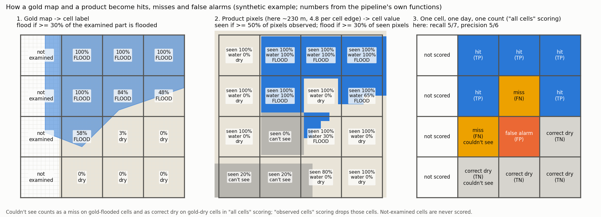

# Flood fusion: how evaluation works, from pixels to scores

The reference for *what is counted and how* in flood fusion v1. It covers:
- how gold maps and products become grid-cell values;
- how a cell becomes a hit, miss or false alarm;
- how those counts become recall, precision, the model's accuracy table, reliability and timing.

Every threshold below is given with its config key (`configs/fusion.yaml`) and its decision or assumption number (`docs/decisions.md`, `docs/assumptions.md`), so it can be checked against the code. Results live elsewhere (`docs/final_report.md`); this page only explains the mechanics.

*Written 2026-10-13 for v1 as built (branch `feat/flood-fusion-v1`); §10 added 2026-10-14 for the cross-validated re-run, which changes some of the v1 rules below. If the code changes a rule, change it here in the same commit.*

## In one paragraph

Everything is put on one global grid of 0.01° cells (about 1.1 km). A gold map (Copernicus EMS or UNOSAT) gives each cell it examined a label for its map date: flooded, dry, or none. Each product (GFM, VIIRS, MODIS, FloodScan, GFDS) gives each cell a value for each day: flood, dry, or "couldn't see". Fusion gives a probability, which counts as flood at P ≥ 0.5. **Scoring compares the two cell by cell, day by day.** Each labelled cell on each gold-map day is one count in a 2 × 2 table (hit, false alarm, miss, correct dry). The counts are summed over all cells, days and events, and recall and precision come from those sums. Cells without a gold label are never scored.

*Synthetic example; every number in it comes from the pipeline's own functions (`scripts/fusion/figure_scoring_mechanics.py`).*

## 1. The grid and the floodable domain

| what | rule | config key / reference |
|---|---|---|
| cell | 0.01° × 0.01°, EPSG:4326, edges at multiples of 0.01° from (−180, 90); integer row and column | `grid.res_deg`; `fusion/grid.py` |
| floodable | at least 30% of the cell has HAND (height above nearest drainage) below 15 m | `static.hand.threshold_m`, `floodable_min_frac` |
| permanent water (excluded) | at least 50% of the cell has JRC GSW occurrence of 90% or more | `static.gsw.permanent_occurrence`, `permanent_min_frac` |
| domain | floodable and not permanent water. Nothing outside it is predicted or scored | `fusion/static.py` |
| land type | urban if built-up ≥ 20%, else vegetated if tree cover ≥ 30%, else open (ESA WorldCover). Urban wins | `static.worldcover.*` |
| snow season | a calendar month whose mean ERA5-Land snow cover (2014–2023, 0.25°) is at least 50% | `static.snow.*` |
| stratum | land type × snow season: six strata. The model's accuracy figures are per stratum | `static.stratum` |

These fractions are sampling estimates: fine rasters are read at every 4th pixel (`static.sample_read_step`), giving 80–900 samples per cell.

## 2. Gold maps become cell labels

A gold map has two parts: **flood polygons**, and the **area the analyst examined** (the "valid" area). Both are rasterised at 0.001°, so **each cell holds 10 × 10 = 100 sub-pixels**. A sub-pixel counts if its centre is inside the polygon. Averaging the sub-pixels gives two fractions per cell (`gold.burn_fraction`):

| label | rule (all must hold) | config key |
|---|---|---|
| **none** | less than 50% of the cell was examined | `gold.valid_min_frac` (0.50) |
| **flooded** | examined, and at least 30% *of the examined part* is flooded | `gold.flood_threshold` (0.30) |
| **dry** | examined, under 30% flooded, and under 30% "possible flood" | `gold.possible_exclude_frac` (0.30) |
| **none** | examined, not flooded, but at least 30% "possible flood" | as above |

- Several maps of the same event on the same day are combined; flood wins over dry (`gold.truth_for_window`).
- **The gold-map days** run from the event's first to its last map date.
- **Dry windows.** For training and for reliability, fixed decision 5 adds the 30 days before the first map and the 60 days after the last (`gold.dry_pre_days`, `dry_post_days`).
  - In those days **every examined cell is labelled dry**, including cells that were flooded on the gold days (D-12, assumption A-02).
  - This was measured to inflate false alarms badly (D-39). A corrected variant, `gold.corrected_dry_windows`, leaves formerly flooded cells unlabelled there; it is proposed, not adopted.

## 3. Each product becomes a cell value

Every product is turned into the same three values per cell per day: **1 = flood, 0 = dry, 255 = couldn't see** (fixed decision 1). "Couldn't see" is never dry. For pixel products, each pixel goes to the cell that contains its centre.

| product | native pixel | "couldn't see" comes from | cell is observed if | cell is flood if | code |
|---|---|---|---|---|---|
| **GFM** (Sentinel-1) | 20 m, read at 80 m (D-08) | no scene, product NoData, exclusion mask, snow/frozen advisory flags 1/3 (D-17) | at least 50% of the cell's expected pixels observed | at least 30% of observed pixels are flood | `sources/gfm.py` |
| **VIIRS** (NOAA flood map) | 375 m | cloud, shadow, snow/ice, no data | at least 50% of pixels observed | mean flood fraction of observed pixels at least 0.30 | `sources/viirs.py` |
| **MODIS** (NASA MCDWD, experiment) | about 230 m (4.8 per cell edge) | "insufficient data" (cloud, no pass) | at least 50% of pixels observed | flood or seasonal-flood pixels at least 30% of observed (`recurring_as`) | `sources/modis.py` |
| **FloodScan** | about 9 km (300″) | outside its regions or archive | always, inside its regions | the containing FloodScan cell's flooded fraction (SFED) at least 0.30. About 80 of our cells copy one value and flip together (D-03) | `sources/floodscan.py` |
| **GFDS** | 0.09° (9 × 9 of our cells) | sentinel values, missing day | when the signal is valid | physics-based flooded fraction at least 0.30 | `sources/gfds.py` |
| **microwave vote** | — | both FloodScan and GFDS couldn't see | either observed | either says flood (fixed decision 2) | `sources/__init__.py: merge_microwave` |

The thresholds are `sources.<name>.observed_min_frac` (0.50) and `sources.<name>.flood_threshold` (0.30).

**Resolution consequence (A-10).** A cell is "flooded" only when at least 30% of it is flooded, in the gold map and in a product alike. A river spilling over 10% of a cell is dry in both. A cell that gold has at 20% and a product sees at 35% scores as a false alarm, even though the product saw real water.

## 4. Fusion's value

For each cell and day, fusion adds up evidence in log-odds (`fusion/engine.py`):
- a source saying flood adds log(sens / (1 − spec));
- a source saying dry adds log((1 − sens) / spec);
- "couldn't see" adds nothing.

Yesterday's value carries over with decay 0.9 towards the prior: L = prior + 0.9 · (L_yesterday − prior) + evidence (fixed decision 6). P = 1 / (1 + e^−L), and **fusion counts as flood when P ≥ 0.5** (`fusion.prob_threshold`). The sensitivity and specificity are the per-stratum accuracy table (§7); the prior is the per-stratum base rate (D-35).

## 5. Scoring: one cell, one gold day, one count

| | gold: flooded | gold: dry | no gold label |
|---|---|---|---|
| product: flood | **hit (TP)** | **false alarm (FP)** | not scored |
| product: dry | **miss (FN)** | **correct dry (TN)** | not scored |
| product: couldn't see | miss in "all cells" scoring; dropped in "observed cells" scoring | correct dry in "all cells" scoring; dropped in "observed cells" scoring | not scored |

- **Recall** = TP / (TP + FN): the share of gold-flooded cells the product flags.
- **Precision** = TP / (TP + FP): the share of the product's flood calls that gold confirms.
- **CSI** = TP / (TP + FP + FN): one number combining both. It's what criterion (b) uses.
- **"All cells" scoring** (`mode = all`) puts a product's gaps against it: couldn't see on a flooded cell is a miss. That lowers recall only, never precision.
- **"Observed cells" scoring** (`mode = conditional`) scores only the cells a product observed. Fusion is scored on the same cells for a fair comparison (`fusion|gfm` etc.).

**A worked example.** One gold-map day, 100 labelled cells, 30 flooded. The product flags 25 cells, 20 of them among the 30 flooded. That gives TP 20, FP 5, FN 10, TN 65, so recall 20/30 = 0.67 and precision 20/25 = 0.80.

## 6. From counts to totals

- **Pooled cell-days.** Counts are summed over every labelled cell, every gold day and every event, then the scores are computed from the sums (`metrics.add_scores`, `validate.skill_table`). This is a "micro-average": **an event with 10,000 flooded cell-days weighs 100 times more than one with 100.** It is not an average of per-event scores.
- **Splits.** The same sums are taken per stratum and per continent.
- **Held out means held out.** Validation uses only the 49 held-out events (`results/event_split.csv`, split by river basin). Nothing is fitted on them.
- **Event-level exception.** Time to first detection works per event window: an event counts as "detected" on the first day at least 10% of its gold footprint is flagged (`validate.timing_row`).

## 7. Which days and cells each number uses

| number | events | days | cells | where |
|---|---|---|---|---|
| validation recall, precision, CSI (criterion b) | held-out | gold-map days only | labelled cells, all or observed | `scripts/fusion/phase5_validate.py`, `results/phase5_skill_*.csv` |
| accuracy table: sensitivity | training | gold-map days (flood labels exist only there) | labelled cells the source observed | `fusion/table.py: gold_table` |
| accuracy table: specificity | training | gold-map days plus every day of the dry windows | labelled dry cells the source observed | same |
| reliability, criterion (c) | held-out | gold-map days plus dry windows | labelled cells | `validate.reliability_rows`; on gold days only in D-39 |
| prior (base flood rate) | the global random sample (53 places, 2023–2025), not events | every day | GFM-observed cells | `table.build_prior_v1` (D-35) |

- **Sensitivity and specificity are Jeffreys-smoothed:** (TP + 0.5) / (TP + FN + 1), so they are never exactly 0 or 1 (D-32).
- **Intervals** come from resampling whole events (bootstrap).
- **Thin strata** (the three snow strata) are filled by EM from the neighbouring stratum and flagged (D-24).

## 8. Known traps

1. **Precision is measured inside mapped event areas on event days.** In the held-out set, 22% of labelled open-land cell-days are flooded. On ordinary days the flood rate is far lower (about 0.16% in open land, prior v1), so the same false-alarm rate gives much lower precision.
   - As an illustration, *implied by the formula, not measured*: with VIIRS's training recall 0.66 and its corrected false-alarm rate of 2.6%, precision on ordinary open-land days would be about 0.66·0.0016 / (0.66·0.0016 + 0.026·0.998) ≈ **0.04**.
   - Measuring ordinary-day precision needs non-event data. The global random sample is the candidate, with GFM as stand-in truth.
2. **Dry-window labels** (A-02, D-39). They mark still-flooded cells as dry, so receding water scores as false alarms. That inflates false-alarm rates and most of the measured over-confidence.
3. **Resolution** (A-10). Floods covering under 30% of a cell are invisible to scoring, in gold and products alike.
4. **Coarse products flip in blocks.** One FloodScan cell (about 9 km) sets about 80 of our cells at once, so its errors come in clusters.
5. **Gold is not perfect truth.**
   - Analysts map what they could see and examine; unmapped water inside the examined area counts as dry.
   - Many CEMS maps are drawn from Sentinel-1, the same satellite as GFM. Results are therefore also reported for events whose gold is not Sentinel-1-derived (`frac_s1_sets == 0`).
   - The gold maps count seasonal water as flood: 22–26% of gold flood lies on normally-wet cells (D-38).
6. **Pooling favours big events** (§6). A product that does well on a few large floods can look good overall while failing on many small ones.

## 9. Where it lives in the code

| step | code |
|---|---|
| grid, windows, cell index | `src/ds_flood_gfm/fusion/grid.py` |
| domain, land type, snow season, strata | `src/ds_flood_gfm/fusion/static.py` |
| gold rasterising and labels; corrected dry windows | `src/ds_flood_gfm/fusion/gold.py` (`burn_fraction`, `truth_for_window`, `corrected_dry_windows`) |
| dry windows in the event cubes | `src/ds_flood_gfm/fusion/cube.py` |
| product adapters | `src/ds_flood_gfm/fusion/sources/` |
| fusion engine | `src/ds_flood_gfm/fusion/engine.py` |
| confusion counts, scoring modes, reliability, timing | `src/ds_flood_gfm/fusion/validate.py`, `src/ds_flood_gfm/fusion/metrics.py` |
| accuracy table, EM, prior | `src/ds_flood_gfm/fusion/table.py`, `src/ds_flood_gfm/fusion/accuracy.py` |
| cross-validated re-run (§10) | `src/ds_flood_gfm/fusion/crossval.py`, `scripts/fusion/phase5_crossval.py`, folds in `src/ds_flood_gfm/fusion/events.py` (`assign_folds`) and `scripts/fusion/make_folds.py` |
| all thresholds | `configs/fusion.yaml` |

## 10. The cross-validated re-run (from 2026-10-14; ADRs 0003–0007)

The re-run keeps §1–§5 (grid, labels, product values, fusion, one count per labelled cell) and changes how events, strata and dry days are used.

| | v1 (§6–§7) | re-run |
|---|---|---|
| events | 198 on six continents, quotas and size caps; 149 fit, 49 scored | the 170 usable events in Africa, Asia, South America and Oceania (`scope.continents`, ADR 0003) |
| testing | one split by basin | five folds by HydroBASINS level-4 basin; each event scored once, by rates fitted on the other four folds (`results/event_folds.csv`, ADR 0004) |
| strata | six (land type × snow season) | three land types; the cubes' code is `landcover × 2 + snow`, land type is `code // 2` (ADR 0005) |
| cells used for fitting | every labelled footprint cell | labelled cells in the floodable domain only, where fusion makes its calls |
| days before and after an event | every examined cell dry | cells flooded on any map day of their window get no label; the others stay dry (`gold.dry_window_rule`, ADR 0006). The old rule is run too, as product `fusion_literal_dry` |
| hit / false-alarm rates | gold; EM for thin strata | gold only, Jeffreys-smoothed; a land type with no observed gold flood for a source stops the run (no EM, no donor) |
| prior | GFM flood share, all 53 sample blocks, six strata | the same rule on the 30 in-scope blocks, per land type |
| headline score | CSI | recall, precision and F1; CSI only for criterion (b) |
| intervals | events resampled from all events | events resampled within each group (continent, land type) |

**Fitting, per fold.** Counts per event, source and land type (`crossval.fit_counts`) are cached once. For fold k, the counts of the events in the other four folds are summed: hit rate = (TP + 0.5) / (TP + FN + 1) from map days (the only days with flood labels), false-alarm rate from map days plus every day before and after. Each land type's row is written to both snow codes so the engine is unchanged (`crossval.fit_table`).

**Scoring.** Every window of a fold's events is run through the engine from its first day (cold start), with that fold's rates. Map-day counts are kept per event, land type and Sentinel-1 flag (`crossval.score_rows`), then summed over all 170 events. The two views of §5 apply. "Non-Sentinel-1" results keep only map days whose gold maps all came from other sensors.

**Reliability** is shown on two label sets: map days only, and map days plus the dry days under the adopted rule.

**Event level** (ADR 0007, `crossval.event_level`, config `event_level`). Per event, the footprint is the floodable cells flooded on any map day in any of its windows (its windows share one day range, so per-day counts add up).
- **Caught:** on some day from 3 days before the first map to 3 days after the last, the product flags at least 10% of the footprint, and at least 5 cells.
- **Days to detection:** the first such day, counted from the first map.
- **False event:** the same rule on days 30 to 10 before the first map.
- **Caught cleanly** (derived, not a separate rule): caught and no false event. A product that flags the same cells for weeks counts as caught at day −3; this column separates that from detection.
- Events with a footprint under 5 cells are listed as not eligible, never dropped silently. The same rules are applied per land type, with the footprint restricted to that land type.

**Outputs:** `results/cv/` (written by `make crossval`; its docstring lists each file).

